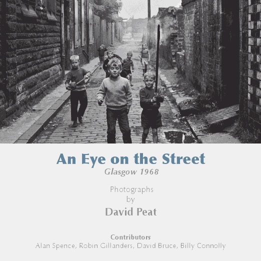

::: hero
Book · by David Peat

# An Eye on the Street

ISBN 978-0-954-3961-3-8
:::

In the late 1960s, twenty-one year old David Peat created a portfolio of photographs to gain entry to the film business. Peat who was regarded as a leading cinematographer and documentary film maker, gave permission for Renaissance Press to publish these remarkable images which have remain unseen by the public for forty years.

The Glasgow photographed in 1968 has long gone, but the sights and smells of that time still exist in the recollections of those who lived as children in the streets and back courts of Gorbals, Tradeston, Maryhill and beyond. The black and white photographs in this book can still sharpen the memory as no other medium can.

**NOTE: No longer available through Renaissance Press. Please contact [Street Level Photoworks](https://www.streetlevelphotoworks.org/).**

By David Peat. Contributors Alan Spence, Robin Gillanders, David Bruce, Billy Connolly.

---

[← Books](books.html) · [Prints](prints.html) · [Folios](folios.html)
