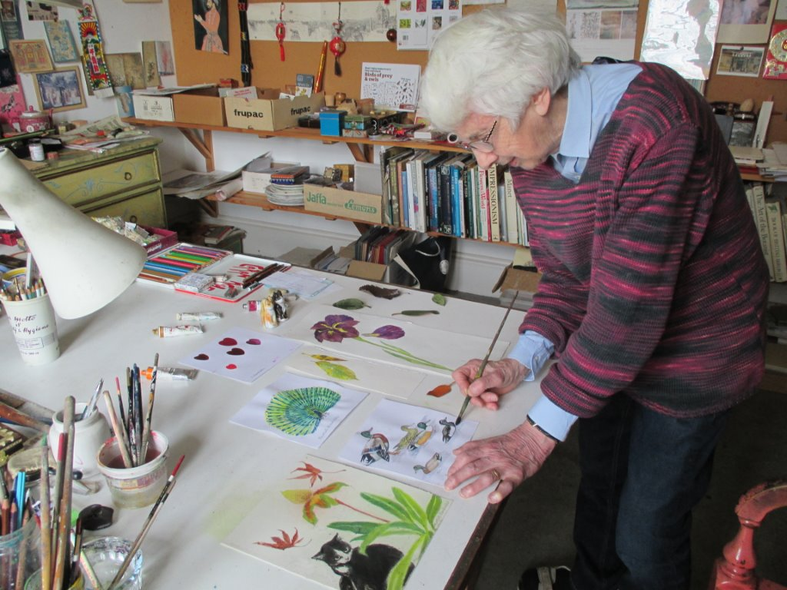

::: hero
In Memoriam

# Elizabeth Blackadder

1931 – 2021
:::

It was Elizabeth Blackadder and George Bruce’s happy collaboration that resulted in *[Through the Letterbox](through-the-letterbox.html)*; and it was through this book that Renaissance Press was born. Elizabeth went on to illustrate two more books for Renaissance Press - *[Morning Glory](morning-glory.html)* with Alan Spence, and *[A Brush with Burns](a-brush-with-burns.html)*, both created with her refined sensitivity and exquisite brushwork.

::: figure

Photo © Lucina Prestige 2021
:::

Elizabeth was born in Falkirk, studied at Edinburgh College of Art, and travelled widely in Europe and the USA, But it was her visits to the Far East and Japan in particular, with her husband John Houston, that had a profound influence on her style. Illustrating George Bruce’s haiku therefore came very naturally. The same was true of the following collaboration with Alan Spence in [Morning Glory](morning-glory.html). Elizabeth’s last book with Renaissance Press was [A Brush with Burns](a-brush-with-burns.html).

Elizabeth Blackadder was a most distinguished lady, the first woman to be a member of both the Royal Scottish Academy and Royal Academy, a Dame of the British Empire, and the Queen’s Limner in Scotland. For us at Renaissance Press she was a most treasured friend and we are deeply saddened by her departure.

*David Bruce and Lucina Prestige*

---

[More about Elizabeth Blackadder →](elizabeth-blackadder.html) · [Books she illustrated →](books.html)
