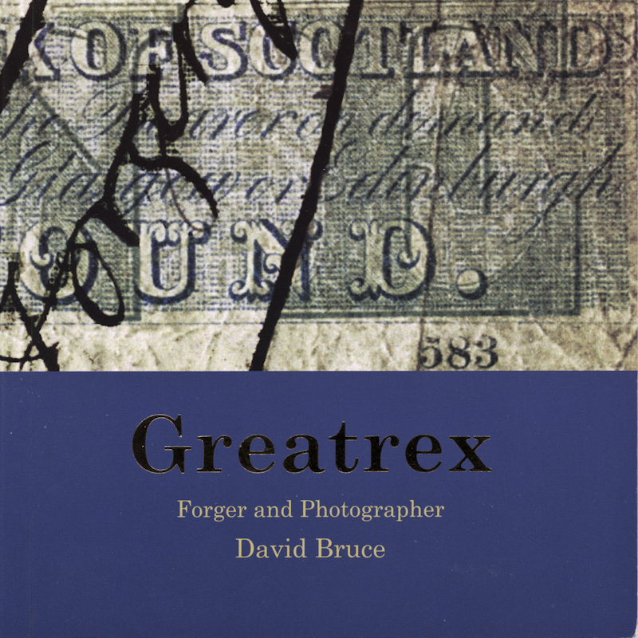

Book · by David Bruce

# Greatrex – Forger and Photographer

£9.99

John Henry Greatrex (1827-76), thief, convict, actor, grocer, photographer, bankrupt, preacher, adulterer, absconder and counterfeiter, had a colourfully disreputable life, despite his entirely respectable Victorian family background.

His dubious career took him from England to Australia, Scotland and America - only for him to be arrested by an extraordinarily clever Glasgow detective, for printing his own money. This is his story and though hard to believe, it is entirely true.

> “The story captures the imagination today for much the same reasons it did in 1867: it is a detective yarn (though it pre-dates Sherlock Holmes by some 20 years), pitting a determined sleuth against a cunning, charismatic crook. Bruce’s book mirrors the fast pace of the action itself, drawing on the thorough documentation which survives from the trial.” - Scotland on Sunday

[Also available on Kindle](http://www.amazon.co.uk/Greatrex-Forger-Photographer-David-Bruce-ebook/dp/B00KPGLRY2/ref=sr_1_1?ie=UTF8&qid=1416694007&sr=8-1&keywords=Greatrex+%E2%80%93+Forger+and+Photographer)

<a href="../contact.html">Order or enquire →</a> &nbsp;·&nbsp; <a href="../books.html">← Books</a> · <a href="../prints.html">Prints</a> · <a href="../folios.html">Folios</a>

