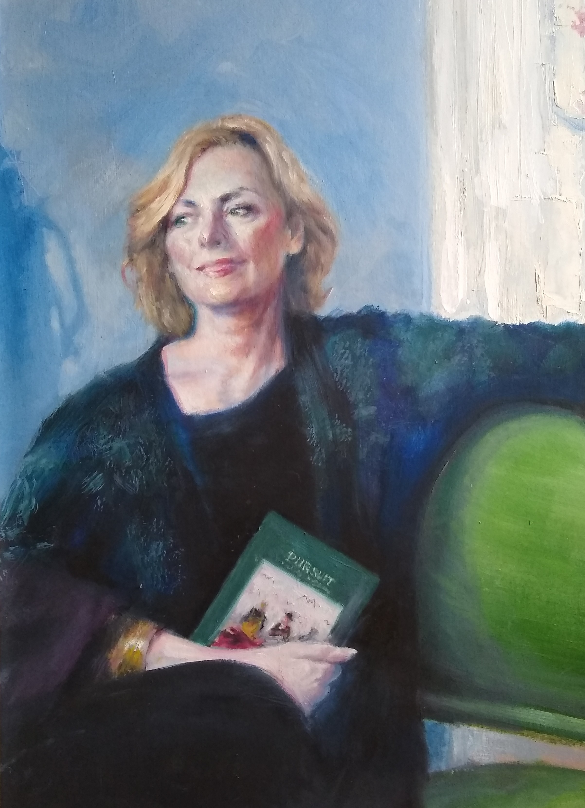

Edinburgh · Scotland

# Renaissance Press

A small publishing house specialising in the collaboration of
poetry and art.

## News

We are very sorry indeed to report that Lucina Prestige, the founder and mainstay
of Renaissance Press, has died at the age of eighty. The Press was very much her
invention, bringing together her skills and experience in senior roles in
publishing and her friendships in the arts in Scotland — particularly with the
poets George Bruce (her neighbour) and Alan Spence, and the artist Dame Elizabeth
Blackadder.

It was indeed the friendship between Bruce and Blackadder that gave rise to the
first of the books, *Through the Letterbox* (2003). Bruce had taken to writing
haiku, but it was Lucina who saw the potential of them and rescued them from the
poet's wastepaper bin. And it was she who recognised that Elizabeth Blackadder,
with her fascination for all things Japanese, was the perfect artist to
illustrate the words. The combination was ideal and, managed by Lucina, worked
remarkably well, as three reprints and many thousands of sales testify. Moreover,
Lucina negotiated the production of prints by Elizabeth as they became
collaborators and great friends.

Friendship has also been key to the subsequent collaboration with Alan Spence
(another poet with strong Japanese interests). *Morning Glory* (2010) and
*Thirteen ways of looking at Tulips* (2022) testify to that, as also to Lucina's
taste, editorial skill, and production values.

It has been a privilege for all of us to have worked with her and known her as a
remarkable friend.

<figure>

<figcaption>Lucina Prestige — portrait by Colin Dunbar, 2001</figcaption>
</figure>

## Latest publications

<ul class="catalogue">
<li class="item">
  <h3><a href="products/letters-from-the-winding-nile-in-1857-william-kidston-writes-home.html">Letters from the Winding Nile</a></h3>
  
In 1857, William Kidston writes home

  
A Glasgow businessman's letters from an 1856 expedition to Egypt
  and the Holy Land.

  
£9.99Book

</li>
<li class="item">
  <h3><a href="products/thirteen-ways-of-looking-at-tulips.html">Thirteen ways of looking at Tulips</a></h3>
  
Alan Spence &amp; Elizabeth Blackadder

  
A beautiful sequence of tulip haiku, exquisitely illustrated.

  
£7.99Book

</li>
<li class="item">
  <h3><a href="products/through-the-letterbox.html">Through the Letterbox</a></h3>
  
George Bruce &amp; Elizabeth Blackadder

  
The book through which Renaissance Press was born.

  
£9.99Book

</li>
</ul>

<a href="books.html">All books →</a> &nbsp;·&nbsp;
<a href="prints.html">Prints →</a> &nbsp;·&nbsp;
<a href="folios.html">Folios →</a> &nbsp;·&nbsp;
<a href="people.html">Artists &amp; authors →</a>

## Elizabeth Blackadder (1931 – 2021)

It was Elizabeth Blackadder and George Bruce's happy collaboration that resulted
in *Through the Letterbox*; and it was through this book that Renaissance Press
was born.
[Read more about Elizabeth Blackadder →](elizabeth-blackadder-1931-2021.html)

## Renaissance Press

We are a small publishing house based in Scotland and will be happy to answer any
questions you may have whilst browsing. You can find our contact details
[here](contact.html).
