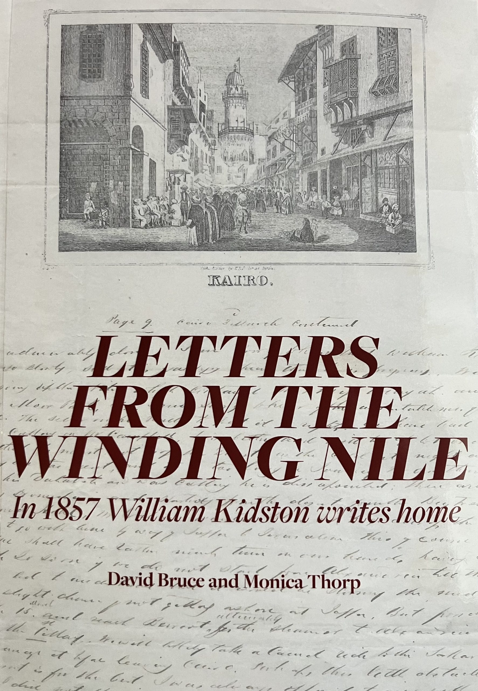

::: hero
Book

# Letters from the Winding Nile - In 1857 William Kidston writes home
:::

In 1856, a prosperous Glasgow businessman, William Kidston (1813 - 1889), set out with two companions on an expedition to Egypt and the Holy Land. As he travelled through Europe, across the Mediterranean, and into the Middle East, he wrote letters to his sister to tell of his progress and of the extraordinary sights and people he encountered. But William had another purpose beyond the pleasure of tourism; as a founding member of the Free Church of Scotland he was determined to find evidence for the truth of the Bible. William's handwriting may have been hard to decipher, but his descriptions and humour; not least in Egypt, provide a vivid insight into the life, times and interests of a Victorian gentleman with means and a mission.

---

[← Books](books.html) · [Prints](prints.html) · [Folios](folios.html)
