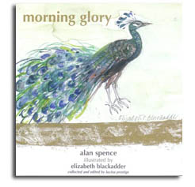

::: hero
Book · by Alan Spence · illustrated by Elizabeth Blackadder

# Morning Glory

ISBN 978-0954-3961-2-1
:::

Renaissance Press announces its latest book – a follow-up to the very popular Through the Letterbox. Again it takes the form of a delightful combination of poetry and art. Morning Glory consists of a beautiful sequence of poems – a mixture of haiku and tanka by poet Alan Spence - complemented by the exquisite illustrations of Elizabeth Blackadder.

**[Elizabeth Blackadder DBE RA RSA](elizabeth-blackadder.html)**

Elizabeth Blackadder is one of Scotland’s finest artists. She studied at Edinburgh College of Art and belongs to a long tradition of Scottish artists whose use of colour is widely recognised. Her interest in Japan (reflected in her work) make her the perfect artist to illustrate a book of haiku and tanka.

**[Alan Spence](alan-spence.html)**

Alan Spence is one of Scotland’s best loved writers. An award winning poet, novelist, short story writer and playwright, he was Professor in Creative Writing at the University of Aberdeen where he was artistic director of the annual WORD Festival. Regarded as a master of the haiku, his previous collections include Glasgow Zen, Seasons of the Heart and Clear Light.

Alan Spence is Edinburgh’s current Makar (a Scots word meaning the role of the poet or author as a skilled and versatile worker in the craft of writing).

By Alan Spence, illustrated by Elizabeth Blackadder. Collected and edited by Lucina Prestige.

---

[← Books](books.html) · [Prints](prints.html) · [Folios](folios.html)
