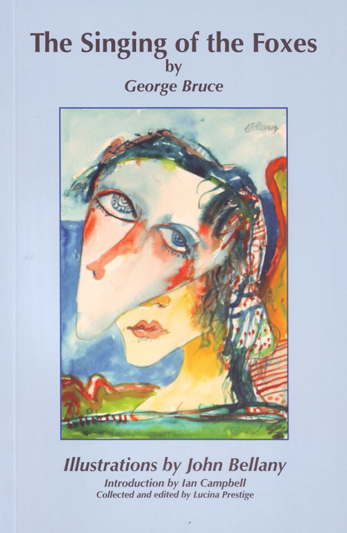

::: hero
Book · by George Bruce · illustrations by John Bellany

# The Singing of the Foxes

ISBN 978-0-9543961-1-4
:::

This volume began life as a new collection of poems. Sadly due to the death of its author, the poet George Bruce, in 2002, it was transformed into a collection of final and uncollected poems.

The book begins with a number of poems written especially for the artist John Bellany - one of these is the title poem.

by George Bruce. Illustrations by John Bellany. Collected and edited by Lucina Prestige.

---

[← Books](books.html) · [Prints](prints.html) · [Folios](folios.html)
