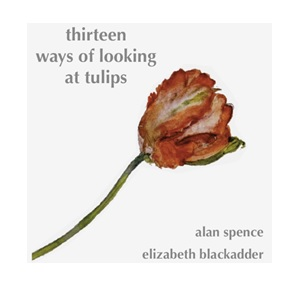

::: hero
Book · By Alan Spence, illustrated by Elizabeth Blackadder

# Thirteen ways of looking at Tulips

ISBN 97809543961169
:::

Our latest book is another fine collaboration by Alan Spence and Elizabeth Blackadder. A beautiful sequence of tulip haiku - illustrated exquisitely by Elizabeth Blackadder. By Alan Spence, illustrated by Elizabeth Blackadder, collected and designed by Lucina Prestige

---

[← Books](books.html) · [Prints](prints.html) · [Folios](folios.html)
