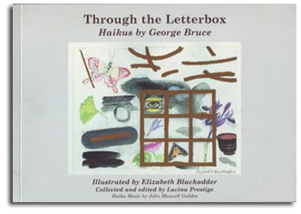

Book · by George Bruce · illustrated by Elizabeth Blackadder

# Through the Letterbox

£9.99 &nbsp;·&nbsp; ISBN 0-9543961-0-3

This charming book is the result of a unique collaboration by two leading practitioners in their fields, the poet George Bruce and the artist Elizabeth Blackadder. The title refers to George Bruce's habit of delivering these little haiku poems, late at night, through the letterboxes of his neighbours and particularly that of the book's editor, Lucina Prestige. The subject-matter of the 157 poems and 143 images ranges from the domestic to the global and beyond: philosophical haiku, cat haiku, bath haiku, garden haiku, fish haiku, delicately illustrated by Elizabeth Blackadder. Bruce's great sense of humour is fully evident is these delightful seventeen-syllable poems, modelled on the Japanese haiku, but so also is his capacity to stir deep feeling in the fewest possible words.

[George Bruce](../people/george-bruce.html), who died in 2002 at the age of 93, was one of the last major figures of the Scottish Literary Renaissance of the twentieth century. His poetry ranges from the evocation of his origins in the port of Fraserburgh on Scotland's north-east coast through philosophical, personal and contemporary issues to the ironic and light-hearted. In 1999, at the age of ninety, he won the Saltire Prize for the best Scottish book of the year for his collection, Pursuit: poems 1986-1998.

[Elizabeth Blackadder](../people/elizabeth-blackadder.html) is one of Britain's favourite artists. She worked with George Bruce on Through the Letterbox in the year before he died. Her instinctive economy of style and her particular interest in Japanese art makes her the ideal illustrator for such a book. Her cats, flowers and Japanese symbols are a perfect response to Bruce's poems. The format of the book, A5 landscape, provides just the right shape and space for this delightful combination of words and images. Elizabeth Blackadder is the Queen's Limner in Scotland and is a Dame of the British Empire.

<a href="../contact.html">Order or enquire →</a> &nbsp;·&nbsp; <a href="../books.html">← Books</a> · <a href="../prints.html">Prints</a> · <a href="../folios.html">Folios</a>

