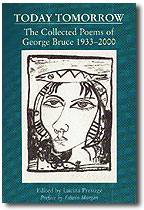

::: hero
Book · (collected poems 1933 – 2000) · by George Bruce

# Today Tomorrow

ISBN 0748662995
:::

This book contains a lifetime's experience of making poems, which is reflected in the wide range of subject matter. From observations of life in a Scottish fishing port to poems about the great painters of the world - El Greco, Rembrandt, Cezanne, Van Gogh and others, and finally the painter John Bellany, Today Tomorrow encompasses an immense range of subject matter from poems about love and everyday events to poems about political matters and universal themes.

> 'George Bruce who at the age of 92 achieved Thomas Hardy's claimed ambition to become the oldest poet of any consequence to publish a book containing new verse' Robert Nye, The Scotsman

> 'The life, work and sheer energy of Bruce is a result of a dedication to the art of poetry few can sustain or hope to match' George Gunn

Polygon 2001. Preface by Edwin Morgan. Collected and edited by Lucina Prestige. Cover Illustration by John Bellany.

---

[← Books](books.html) · [Prints](prints.html) · [Folios](folios.html)
