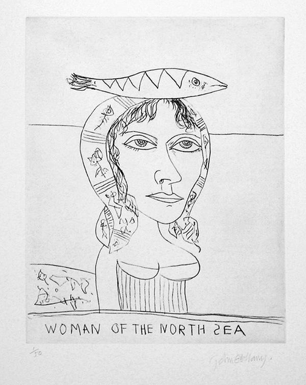

Folio / Print · George Bruce &amp; John Bellany

# Woman of the North Sea

Price on enquiry

Throughout his long life, the poet George Bruce (1909-2002) had a strong affinity with the visual arts and artists. A former BBC arts producer and critic for The Sunday Times, he wrote on painting and sculpture and on many artists including Anne Redpath, Robin Philipson and James Cumming.

In his final years, as well as producing [Through the Letterbox](through-the-letterbox.html) with Dame Elizabeth Blackadder, he also worked with his friend, the artist, [John Bellany](../people/john-bellany.html), on two special projects relating poems to etchings. Though of different generations, Bellany and Bruce shared a common background - the fishing communities of the North Sea.

John Bellany is one of Britain's leading and most influential artists since the second world war. His style is unique and instantly recognisable. Rooted (as is Bruce) in a sense of a community on the sea's edge, his dramatic and emotional images convey life, love and loss against the ever-present backdrop of the hard business of making a living from the sea itself.

Completed in 2002, the title of the portfolio is expressed in George Bruce's poems in response to Bellany's images.

Dimensions 27 x 22.5 inches; 69 x 57 cm

**Price £2,000, Limited edition (50 copies signed by Bruce and Bellany)**

A limited number of individual etchings are also available at £400.00 each.

Prospective purchasers are advised that as these are limited editions, they should make direct contact with Renaissance Press.

<a href="../contact.html">Order or enquire →</a> &nbsp;·&nbsp; <a href="../books.html">← Books</a> · <a href="../prints.html">Prints</a> · <a href="../folios.html">Folios</a>

